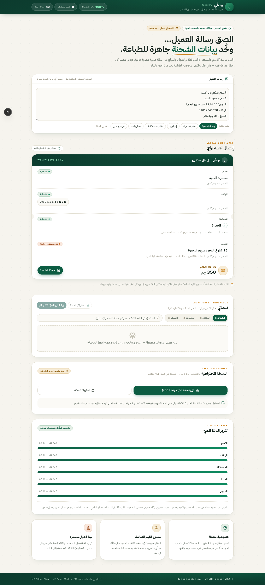
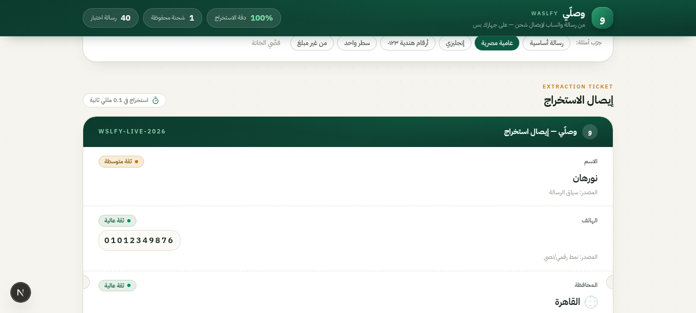

<div dir="rtl">

# وصلّي — Waslfy

**من رسالة واتساب لإيصال شحن — كل حاجة على جهازك.**

> 🔗 **جربه لايف / Try it live:** **[waslfy.pages.dev](https://waslfy.pages.dev)** (Cloudflare) · **[mohamed-khairy-5i.github.io/waslfy](https://mohamed-khairy-5i.github.io/waslfy/)** (GitHub Pages) — يشتغل أوفلاين بعد أول زيارة، وتقدر تثبّته كتطبيق من زر "ثبّت التطبيق".

[](https://github.com/mohamed-khairy-5i/waslfy/actions/workflows/ci.yml)
[](https://mohamed-khairy-5i.github.io/waslfy/)
[](https://www.npmjs.com/package/waslfy-parser)
[](LICENSE)
[](packages/parser)

التاجر المصري بيستقبل عشرات الطلبات يوميًا كرسائل واتساب حرة، وبيقعد ينسخ الاسم والتليفون والعنوان والمبلغ بإيده لشيت شركة الشحن. **وصلّي بيقرأ الرسالة وبيطلّع بيانات الشحنة منظمة في أقل من ملي ثانية** — وبحجب أي بيانات ناقصة قبل الطباعة أو التصدير، لأن شحنات COD الغلط بتتكلف فلوس حقيقية.

| الصفحة الرئيسية | إيصال الاستخراج | الموبايل |
| --- | --- | --- |
|  |  |  |

</div>

---

## Why Waslfy? / ليه وصلّي؟

| | |
| --- | --- |
| 🔒 **Privacy-first / خصوصية مطلقة** | No server, no account, no tracking. The parser runs **in the browser** — customer data never leaves the device. IndexedDB via Dexie for storage. |
| 🚫 **No silent values / ممنوع القيم الصامتة** | Every field carries `{ value, confidence, source, confirmed }`. Low/empty fields **block printing and exporting** until a human reviews them. No guessed values, ever. |
| 📏 **Measured accuracy / دقة مقاسة** | Not marketing numbers — the accuracy report on the page runs live on the same public corpus used in CI: **100% on all 5 fields (40-message corpus)**, with address being low-confidence-by-design. |
| 🧩 **Zero dependencies / صفر dependencies** | The parser package ships with **0 runtime dependencies** — pure TypeScript, ~10KB. Arabic normalization, Levenshtein governorate matching, Egyptian phone regex, city→governorate map. |
| 🆓 **Zero cost / صفر تكلفة** | Local-first PWA. Deploy the web app free on Cloudflare Pages; the heavy lifting happens on the user's device. |
| 🌍 **Egyptian Arabic first** | Understands عامية (`عايزة طلبي يوصل بسرعة`), Arabic-Indic numerals (`٠١٠١٢٣٤٥٦٧٨`), mixed Arabic/English, one-line dash messages, and 27 governorates with city aliases. |

## What it does / بيعمل إيه

- **Extract** — paste any Egyptian order message: name, phone(s), governorate, address, COD amount. Each with confidence + extraction source (`regex` / `dictionary` / `context`).
- **Review** — human confirmation is mandatory for low-confidence fields. The UI shows *why* every value was extracted.
- **Save** — shipments persist locally (IndexedDB), survive refresh, searchable with Arabic normalization (همزات، ة/ه، ى/ي، أرقام هندية).
- **Print** — A6 packing slip with a real **Code128 barcode** (hand-rolled, zero deps) generated in-browser. Batch printing for all confirmed shipments. Blocked shipments show exactly what's missing.
- **Export** — Excel with ready-made templates for Egyptian carriers + custom columns. Phone numbers exported as text (no `1.2E+10` nonsense).
- **Backup** — one-click JSON export + smart merge import (newest record wins — a stale backup can never destroy newer work).
- **Offline PWA** — install وصلّي as an app on phone/desktop: it boots and works with **zero network** (service worker + cached shell), data stays in IndexedDB.

## Monorepo layout / هيكل المشروع

```
waslfy/
├── packages/parser/    ← waslfy-parser — npm package, zero deps, the core engine
│   ├── src/            ← 5 extractors + normalization + data (27 governorates, city aliases)
│   ├── test/           ← accuracy.test.ts (corpus accuracy + regression tests)
│   └── demo/           ← CLI: npm run demo -- "الاسم: كريم - الجيزة - 01012345678"
└── apps/web/           ← Next.js 16 + React 19 PWA shell (Inbox → Print → Excel → Backup)
```

## Quick start / ابدأ في دقيقة

```bash
git clone https://github.com/mohamed-khairy-5i/waslfy.git
cd waslfy
npm install

# 1) Run the test suite (10 tests: 40-message corpus accuracy + edge-case regressions)
npm test

# 2) Try the CLI demo
npm run demo -- "الاسم: محمود علي - التليفون: 01001234567 - الجيزة - 12 شارع جامعة الدول - كود 450 جنيه"

# 3) Run the web app
npm run web:dev
# → http://localhost:3000
```

## Use the parser / استخدم المحرك

**On npm:** [`waslfy-parser`](https://www.npmjs.com/package/waslfy-parser) — zero dependencies, ESM + CJS + TypeScript types, ~13 kB min+gz.

```bash
npm install waslfy-parser
```

```ts
import { extractShipment } from 'waslfy-parser';

const r = extractShipment(
  'أهلاً أنا نورهان\nمدينة نصر القاهرة 12 شارع عباس العقاد\n01012349876\nكاش 320 ج'
);

r.name.value;          // 'نورهان'
r.name.confidence;     // 'medium' — inferred from context, not a label
r.phones.value;        // ['01012349876']
r.governorate.value;   // { id: 'cairo', name: 'القاهرة' } — via city→governorate map
r.amount.value;        // 320
r.address.confidence;  // 'low' — by design; review before shipping
```

Every field is a `Field<T>`:

```ts
interface Field<T> {
  value: T | null;
  confidence: 'high' | 'medium' | 'low' | 'empty';
  source: 'regex' | 'dictionary' | 'context' | 'user' | 'smart-ai';
  alternatives?: T[];   // e.g. extra phone candidates
  confirmed: boolean;   // set by human review
}
```

**The contract: never trust a value the engine isn't sure about.** Your UI decides what to block — ours blocks printing/export until `confirmed`.

## Accuracy / الدقة

Measured live in CI on the public corpus (`packages/parser/src/data/corpus.ts` — 40 messages: MSA, Egyptian dialect, English, Arabic-Indic numerals, one-liners, edge cases). Empty extraction counts as a miss, not a pass.

| Field | Result | Target |
| --- | --- | --- |
| Phone | **40/40 — 100%** | ≥ 98% |
| Governorate | **40/40 — 100%** | ≥ 95% |
| COD amount | **40/40 — 100%** | ≥ 90% |
| Name | **40/40 — 100%** | ≥ 85% |
| Address | 40/40 informational — confidence **`low` by design** | review always |

Ran a real order the parser gets wrong? **Open an issue with the raw text (redacted) — it becomes a corpus entry and the whole benchmark gets harder.** That's the deal: every failure makes the parser permanently better.

## Roadmap / الخطة

- [x] **M1** — parser + corpus + accuracy CI + CLI
- [x] **M2** — local persistence (IndexedDB/Dexie) + editable cards
- [x] **M3** — A6 print + Code128 barcode + print-blocking gate
- [x] **M4** — Excel export (carrier templates) + backup/restore with smart merge
- [x] **UI v2** — Cairo-paper identity, receipt-style extraction ticket
- [x] **M5** — Offline PWA (installable, works with no network — hand-rolled service worker, no next-pwa dependency)
- [ ] **M6** — Smart Mode (optional AI assist via server-side worker for the hard messages — still no data storage)
- [x] **M7** — npm publish ([waslfy-parser@0.1.0](https://www.npmjs.com/package/waslfy-parser)) + dual hosting (Cloudflare Pages + GitHub Pages)
- [ ] **M7.1** — landing page + demo GIF

## Contributing / تشارك؟

Issues and PRs are welcome — see [CONTRIBUTING.md](CONTRIBUTING.md). The highest-value contribution is **real-world failing messages**: they go straight into the corpus.

## License / الترخيص

[MIT](LICENSE) — free forever, no strings.

<div dir="rtl">

اصنع بحب في مصر 🇪🇬 — ومستوحى من كل تاجر بيعيد كتابة العناوين بإيده آخر اليوم.

</div>
